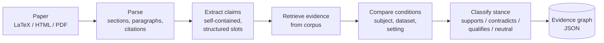

<div align="center">

# SEG: Scientific Evidence Graph

**Find not just which papers are similar, but which papers support, contradict, or qualify a specific scientific claim.**


[Overview](#overview) · [How it works](#how-it-works) · [Quickstart](#quickstart) · [CLI reference](#cli-reference) · [Data model](#data-model) · [Research questions](#research-questions) · [Roadmap](#roadmap) · [Contributing](#contributing)

</div>

---

## Overview

Academic search tools work at the **paper level**: keywords, titles, abstracts, citations, embeddings. But researchers ask **claim-level** questions:

- Which papers support *this specific result*?
- Does any paper contradict it, and under what conditions?
- Has this method been tried on a different dataset?

SEG breaks papers into claims, retrieves candidate evidence passages from other papers, and classifies how each passage relates to the claim. The output is a graph in which **every edge points to an exact quoted span** in a source paper.

> [!NOTE]
> SEG is an early-stage research project. The pipeline below is the design target; see [Status](#status) for what is implemented today.

### Example

```text
Claim (Paper A, §Results):
  "Embedding-based routing improves agent selection accuracy over keyword
   routing on a 5-agent benchmark."

  ├── SUPPORTS     Paper B, p.7 ¶2   "...embedding routing reached 91% vs 78%..."
  ├── CONTRADICTS  Paper C, p.5 ¶4   "...no gain over keyword routing with 20+ agents..."
  └── QUALIFIES    Paper D, p.9 ¶1   "...gains hold only with in-domain fine-tuning..."
```

Note how Paper C is not simply "contradicting": its conditions (20+ agents) differ. SEG compares conditions before assigning stance, because many apparent contradictions disappear once datasets and settings are aligned.

## How it works



| Stage | Input | Output |
|---|---|---|
| **Parse** | LaTeX, HTML, or PDF | `Paper` with sections, paragraphs, citation mentions, offsets |
| **Extract** | check-worthy paragraphs | `Claim` with decontextualized text, subject, outcome, dataset, conditions |
| **Retrieve** | claim | ranked evidence passages from a fixed corpus |
| **Compare** | claim + passage | `ConditionMatch` (same subject? dataset? setting?) |
| **Classify** | claim + passage + match | `EvidenceEdge` with stance, confidence, rationale |
| **Build** | edges | graph (JSON, NetworkX) |

### Design principles

1. **Evidence before generation.** An edge exists only if an exact supporting span exists.
2. **Provenance everywhere.** Every claim and edge traces to paper, page, section, paragraph, and character offsets.
3. **Claim ≠ sentence.** Claims are rewritten to be self-contained, otherwise "our method improves accuracy" cannot be compared with anything.
4. **Claim-level and paper-level relations are different.** Stance (supports/contradicts) is claim-to-passage. Relations like *cites* or *same dataset* come from metadata, not an LLM.
5. **Modular and benchmarked.** Every stage is replaceable and evaluated independently.
6. **Reproducible.** Pinned model and prompt versions, cached LLM calls, versioned schemas, JSON artifacts per stage.

## Status

| Component | State |
|---|---|
| Data schema | ✅ defined ([`schema.py`](src/evidence_graph/models/schema.py)) |
| Parsing design | ✅ documented ([`docs/PARSING.md`](docs/PARSING.md)) |
| PDF / TEI parsing | 🚧 in progress |
| Claim extraction | 📋 planned |
| Retrieval + baselines | 📋 planned |
| Stance classification | 📋 planned |
| Graph export | 📋 planned |
| Review UI | 📋 planned |

See [`ROADMAP.md`](ROADMAP.md) for milestones and exit criteria.

## Quickstart

**Requirements:** Python 3.11+, [uv](https://docs.astral.sh/uv/), Docker (only for GROBID PDF parsing).

```bash
git clone https://github.com/glemiu6/SEG.git
cd SEG
uv sync
```

Start GROBID for PDF parsing (optional if you use arXiv LaTeX/HTML sources):

```bash
docker run --rm -p 8070:8070 lfoppiano/grobid:0.8.1
```

Configure your LLM provider:

```bash
cp .env.example .env   # then set your API key and model names
```

Recommend related papers from a local PDF (internet access is required for the
OpenAlex search):

```bash
uv run seg data/papers/example.pdf
```

Useful filters can be combined:

```bash
uv run seg paper.pdf --venue NeurIPS --from-year 2022 --open-access --limit 10
uv run seg paper.pdf --from-year 2020 --json
```

The CLI extracts text locally, builds search terms from the title and opening
pages, and queries OpenAlex. Each recommendation includes authors, year, venue,
research areas, a short abstract-based summary, and a DOI or landing-page link.
Image-only scanned PDFs are reported clearly; OCR is planned for a later phase.

### CLI reference

Run `uv run seg --help` to see the installed version's options. All current
arguments can be combined unless noted below.

| Argument | Default | Purpose |
|---|---:|---|
| `paper` | required | Path to a text-based PDF. This is the only positional argument. |
| `-h`, `--help` | — | Show command usage and exit. |
| `--venue NAME` | any | Keep conference or journal names containing `NAME`, case-insensitively. |
| `--from-year YEAR` | any | Set the earliest publication year. |
| `--to-year YEAR` | any | Set the latest publication year; it cannot precede `--from-year`. |
| `--open-access` | off | Return only papers marked open access by OpenAlex. |
| `--limit N` | `5` | Return `N` final results; valid range: 1–50. |
| `--json` | off | Emit machine-readable JSON instead of formatted terminal output. |
| `--llm` | off | Generate summaries, research areas, and relevance explanations with Ollama. |
| `--model NAME` | `qwen3:8b` | Select the Ollama generation model; used only with `--llm`. |
| `--ollama-url URL` | `http://localhost:11434` | Use another Ollama server for generation and embeddings. |
| `--rerank` | off | Semantically rerank an expanded OpenAlex result set using local embeddings. |
| `--embedding-model NAME` | `bge-m3` | Select the Ollama embedding model; used only with `--rerank`. |
| `--candidate-pool N` | `30` | Number of OpenAlex candidates considered by `--rerank`; must be between `--limit` and 100. |
| `--cache-path PATH` | `data/cache/seg.sqlite3` | Store persistent OpenAlex, embedding, and LLM cache entries at `PATH`. |
| `--no-cache` | off | Disable all persistent cache reads and writes for this run. |

Common combinations:

```bash
# Filtered OpenAlex search with readable terminal output
uv run seg paper.pdf --venue NeurIPS --from-year 2022 --to-year 2025 --open-access

# Local semantic ranking, followed by local LLM explanations
uv run seg paper.pdf --rerank --candidate-pool 50 --limit 10 \
  --embedding-model bge-m3 --llm --model llama3.1:8b

# Automation-friendly output without using persistent cache entries
uv run seg paper.pdf --rerank --llm --json --no-cache

# Remote Ollama-compatible server and custom cache location
uv run seg paper.pdf --rerank --llm --ollama-url http://192.168.1.20:11434 \
  --cache-path /tmp/seg.sqlite3
```

### Local LLM enrichment

SEG can optionally use a local [Ollama](https://ollama.com/) model to replace the
extractive abstract preview with a concise summary, refined research areas, and
an explanation of why each candidate is relevant to the uploaded paper. Install
Ollama, start it, and download the default model:

```bash
ollama serve
ollama pull qwen3:8b
uv run seg paper.pdf --llm
```

Choose another installed model or server when needed:

```bash
uv run seg paper.pdf --llm --model llama3.1:8b
uv run seg paper.pdf --llm --ollama-url http://localhost:11434 --json
```

The LLM feature is optional. Without `--llm`, SEG requires no local model and
continues to use the first two abstract sentences as the summary. Candidates
without an OpenAlex abstract are not sent to the model.

### Semantic reranking

OpenAlex search relevance is useful for finding candidates, but matching words
does not always mean that two papers address the same problem. SEG can rerank a
larger candidate pool using a local Ollama embedding model:

```bash
ollama pull bge-m3
uv run seg paper.pdf --rerank --limit 5
```

By default, SEG fetches 30 candidates, embeds the uploaded paper and all
candidate abstracts in one local batch, computes cosine similarity, and returns
the five closest candidates. Control the pool and model explicitly when needed:

```bash
uv run seg paper.pdf --rerank --candidate-pool 50 --limit 10
uv run seg paper.pdf --rerank --embedding-model mxbai-embed-large
```

Reranking and LLM analysis can be combined. Reranking happens first, so the
generative model processes only the final results:

```bash
uv run seg paper.pdf --rerank --llm --limit 5 --model llama3.1:8b
```

The embedding model receives at most 12,000 characters of source opening text
and 12,000 characters from each available candidate abstract. Candidates without
abstracts are placed after candidates that can be scored. The CLI displays the
cosine similarity, and JSON output includes it as `semantic_score`.

### Persistent cache

SEG caches successful OpenAlex responses, individual embedding vectors, and LLM
analyses in a local SQLite database. Caching is enabled by default at
`data/cache/seg.sqlite3`; the directory is ignored by Git. OpenAlex entries
expire after 24 hours. Embeddings and analyses remain reusable because their
keys include the exact input, model, generation options, and cache schema
version. Changing any relevant input creates a different entry.

Use another location or disable caching for a run:

```bash
uv run seg paper.pdf --cache-path /tmp/seg-cache.sqlite3
uv run seg paper.pdf --no-cache
```

Failed requests and malformed model responses are never cached. SQLite keeps
the CLI and TUI serverless while allowing a later migration to PostgreSQL for a
multi-user web deployment.

#### LLM data flow

```text
local PDF -> title + opening text -> search terms -> OpenAlex candidate pool
                                                     |
                         optional local embeddings --+-> semantic reranking
                                                               |
                    source title + shortened text ---+
                    candidate title + abstract ------+-> local Ollama
                    OpenAlex topic labels -----------+       |
                                                            v
                                      summary + areas + relevance
```

PDF extraction and query construction happen locally. OpenAlex receives only
the generated search terms and objective filters. For each result, Ollama
receives the source title, at most 6,000 characters from the source's opening
pages, the candidate title, at most 8,000 abstract characters, and OpenAlex's
topic labels. The model does not receive either PDF file, search the internet,
or apply year, venue, and open-access filters. Its JSON response is validated
with Pydantic before it is displayed. The relevant code is separated into
`llm/client.py`, `llm/prompt.py`, `llm/schema.py`, and `llm/summarizer.py`.

Run tests:

```bash
uv run pytest
```

## Data model

All stages exchange validated [Pydantic](https://docs.pydantic.dev) models.

```text
Paper ── Section ── Paragraph ── CitationMention
  │
  └── Claim ── EvidenceEdge ──▶ Span (exact evidence in another paper)
                    │
                    ├── stance: supports | contradicts | qualifies | neutral
                    ├── confidence, rationale
                    └── condition_match
PaperRelation: cites | same_dataset | same_method   (from metadata, not LLM)
```

A claim looks like this:

```json
{
  "id": "arxiv:2401.01234:c7",
  "original_text": "Our router improves accuracy by 6 points.",
  "canonical_text": "Semantic-similarity routing improves agent selection accuracy by 6 points over keyword routing on RouterBench.",
  "type": "result",
  "subject": "semantic-similarity routing",
  "comparator": "keyword routing",
  "outcome": "agent selection accuracy",
  "direction": "increase",
  "value": "+6 points",
  "dataset": "RouterBench",
  "conditions": ["5 agents", "English"],
  "source": { "paper_id": "arxiv:2401.01234", "section_id": "…:s4", "page_start": 7 }
}
```

An edge looks like this:

```json
{
  "claim_id": "arxiv:2401.01234:c7",
  "stance": "qualifies",
  "confidence": 0.78,
  "rationale": "Gains reported only with in-domain fine-tuning; the original claim states no such condition.",
  "evidence": { "paper_id": "arxiv:2402.05555", "page_start": 9, "text": "…" },
  "condition_match": { "same_subject": true, "same_dataset": false }
}
```

## Research questions

SEG doubles as a testbed for scientific information retrieval:

- **RQ1.** Does claim-level retrieval find contradicting and qualifying evidence better than abstract-level retrieval?
- **RQ2.** Does structure-preserving parsing improve claim extraction?
- **RQ3.** Can LLMs reliably classify stance between scientific claims, once conditions are compared?

Planned evaluation: SciFact / SciFact-Open for sanity checks, plus a hand-labeled gold set with inter-annotator agreement. Baselines include BM25, SPECTER2, cross-encoder rerankers, NLI models, and LLMs. Ablations cover retrieval granularity, parsing quality, claim decontextualization, and embedding models.

### Results

*Pending. This table will be filled in as milestone M3 completes.*

| Retrieval level | Recall@10 | Contradiction-recall@10 |
|---|---|---|
| Abstract (BM25) | – | – |
| Abstract (SPECTER2) | – | – |
| Paragraph (dense) | – | – |
| Claim (dense) | – | – |

## Repository layout

```text
src/evidence_graph/
├── models/       # Pydantic schema
├── ingestion/    # PDF/TEI/LaTeX → sections, paragraphs
├── extraction/   # claim extraction
├── llm/          # client, prompts, cache
├── retrieval/    # corpus index, embeddings, reranking
├── relations/    # stance classification
├── graph/        # builder, exporters
├── storage/      # JSON artifact store
└── pipeline/     # stage orchestration
data/             # papers, parsed, results (git-ignored)
experiments/      # benchmarks, notebooks, results
docs/             # design docs
tests/
```

## Roadmap

1. Schema, LLM client with caching *(M0)*
2. Parsing: arXiv LaTeX/HTML, GROBID *(M1)*
3. Corpus and claim extraction *(M2)*
4. Gold set and baselines *(M3)*
5. End-to-end vertical slice *(M4)*
6. Ablations and error analysis *(M5)*
7. Review UI and graph visualization *(M6)*
8. Write-up and release *(M7)*

Deferred until the core is validated: `EXTENDS` relations, Obsidian export, FastAPI/React frontend, FAISS at scale.

Details in [`ROADMAP.md`](ROADMAP.md).

## Related work

SEG builds on, and aims to differ from:

- [SciFact](https://github.com/allenai/scifact): claim verification against abstracts
- [scite](https://scite.ai): supporting/contrasting citation statements
- Citation intent classification (SciCite, ACL-ARC)
- [S2ORC](https://github.com/allenai/s2orc) / [unarXive](https://github.com/IllDepence/unarXive): structured full-text corpora
- [ORKG](https://orkg.org): structured scholarly knowledge

The difference: claim-to-passage evidence retrieved beyond direct citations, with condition-aware stance and exact-span provenance.

## Contributing

Contributions are welcome, especially:

- annotated claim/evidence pairs
- parser comparisons on papers from your field
- new baselines for retrieval or stance classification

Open an issue before large changes. Run `uv run pytest` and keep schema changes versioned.

## Citation

```bibtex
@software{seg2026,
  title  = {SEG: Scientific Evidence Graph},
  author = {Your Name},
  year   = {2026},
  url    = {https://github.com/glemiu6/SEG}
}
```

## License

MIT. See [`LICENSE`](LICENSE).
